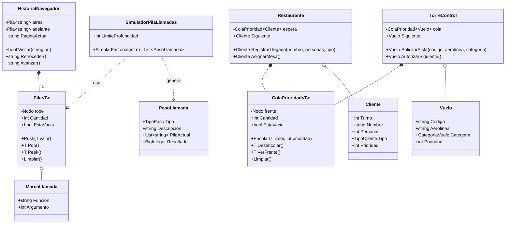
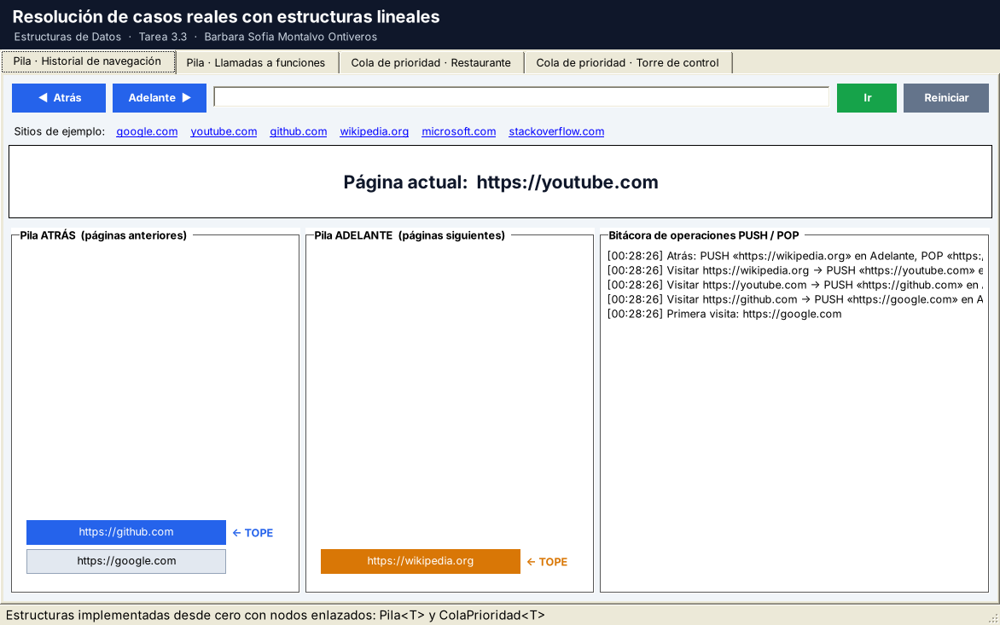
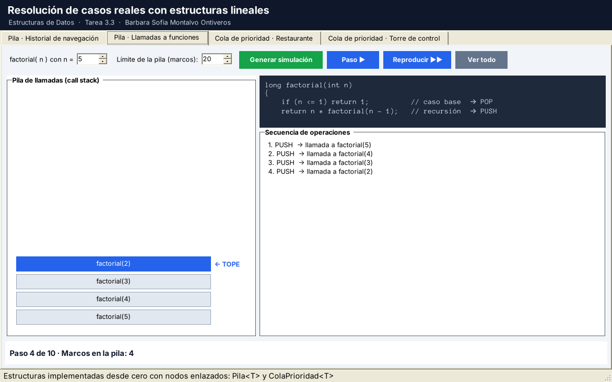
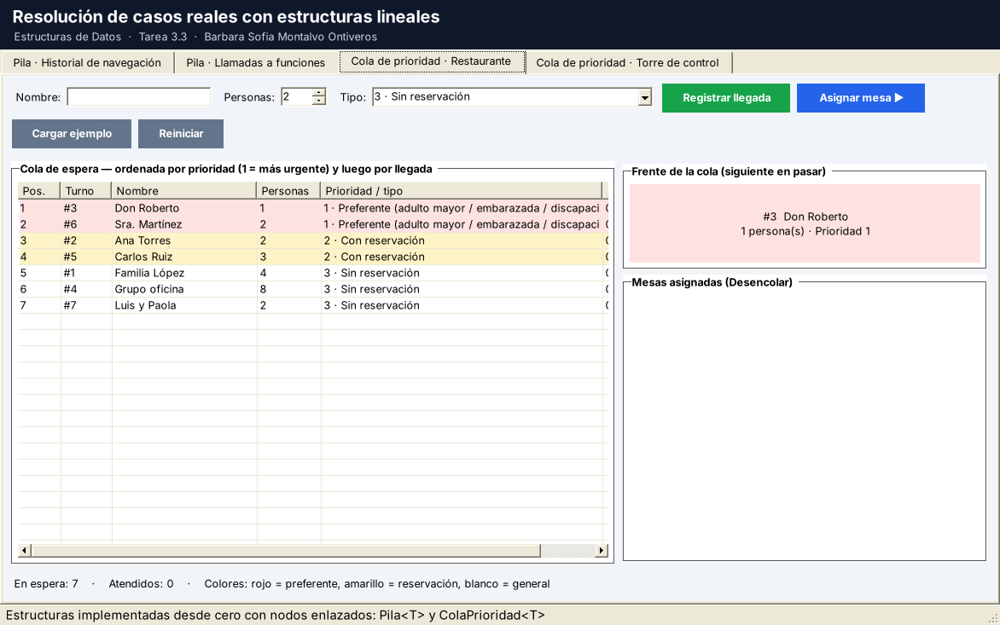
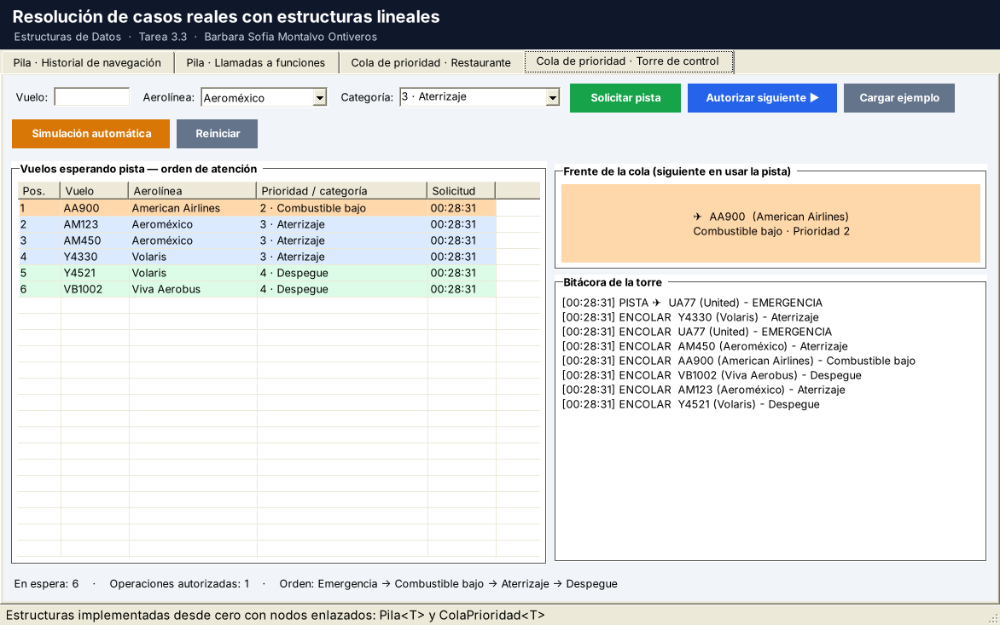

# Práctica 3.3 – Resolución de casos reales con estructuras lineales

**Alumna:** Barbara Sofia Montalvo Ontiveros · **Matrícula:** I25050373
**Asignatura:** Estructuras de Datos · **Docente:** Ruben Riojas
**Instituto Tecnológico Superior de Monclova** – Ingeniería en Informática
**Unidad 3:** Estructuras lineales

🎥 **Video explicativo:** https://youtu.be/riddS5T-dTg

---

Aplicación de escritorio en **C# / Windows Forms (.NET 8)** que resuelve cuatro problemas reales con **pilas** y **colas de prioridad** implementadas desde cero con nodos enlazados (sin usar `Stack<T>` ni `PriorityQueue<T>` de .NET).

| Pestaña | Estructura | Problema real |
|---|---|---|
| Historial de navegación | 2 × `Pila<string>` | Botones **Atrás / Adelante** de un navegador web |
| Llamadas a funciones | `Pila<MarcoLlamada>` | **Call stack** de `factorial(n)` recursivo, con detección de *Stack Overflow* |
| Restaurante | `ColaPrioridad<Cliente>` | Lista de espera: preferentes → reservación → sin reservación |
| Torre de control | `ColaPrioridad<Vuelo>` | Una pista: emergencia → combustible bajo → aterrizaje → despegue |

## Requisitos
- Windows 10/11
- [Visual Studio 2022](https://visualstudio.microsoft.com/) con la carga de trabajo **Desarrollo de escritorio de .NET** (incluye el SDK de .NET 8)

## Cómo ejecutar
**Visual Studio:** abrir `EstructurasLineales.sln` → clic derecho en `EstructurasLineales.App` → *Establecer como proyecto de inicio* → **F5**.

**Consola:**
```bash
dotnet run --project src/EstructurasLineales.App
```

## Cómo ejecutar las pruebas (22 casos)
```bash
dotnet test
```
En Visual Studio: menú **Prueba → Ejecutar todas las pruebas**.

Resultado: **22 casos aprobados** (24 ejecuciones, porque CP-18 prueba tres datos inválidos).

| ID | Clase | Caso | Resultado |
|---|---|---|---|
| CP-01 | Pila | Push 1, 2, 3 y tres Pop → 3, 2, 1 | ✔ |
| CP-02 | Pila | Peek no extrae | ✔ |
| CP-03 | Pila | Pop / Peek en pila vacía → excepción | ✔ |
| CP-04 | Pila | Recorrido del tope al fondo y Limpiar | ✔ |
| CP-05 | ColaPrioridad | Prioridades 3, 1, 2 → salen 1, 2, 3 | ✔ |
| CP-06 | ColaPrioridad | Empates en orden de llegada (FIFO) | ✔ |
| CP-07 | ColaPrioridad | Desencolar / VerFrente vacía → excepción | ✔ |
| CP-08 | ColaPrioridad | Cantidad al encolar y desencolar | ✔ |
| CP-09 | HistorialNavegador | Atrás regresa a la página anterior | ✔ |
| CP-10 | HistorialNavegador | Adelante recupera la página | ✔ |
| CP-11 | HistorialNavegador | Visitar una página nueva vacía Adelante | ✔ |
| CP-12 | HistorialNavegador | Retroceder sin historial → excepción | ✔ |
| CP-13 | HistorialNavegador | URL vacía rechazada; misma URL no altera | ✔ |
| CP-14 | SimuladorPilaLlamadas | factorial(5) = 120 con pila vacía al final | ✔ |
| CP-15 | SimuladorPilaLlamadas | Profundidad máxima = n | ✔ |
| CP-16 | SimuladorPilaLlamadas | Recursión profunda → Stack Overflow | ✔ |
| CP-17 | Restaurante | Preferentes pasan antes | ✔ |
| CP-18 | Restaurante | Nombre vacío, 0 y 13 personas rechazados | ✔ |
| CP-19 | Restaurante | Asignar mesa sin clientes → excepción | ✔ |
| CP-20 | TorreControl | Emergencia obtiene la pista primero | ✔ |
| CP-21 | TorreControl | Vuelo duplicado rechazado | ✔ |
| CP-22 | TorreControl | Código con formato inválido rechazado | ✔ |

## Estructura del proyecto
```
EstructurasLineales.sln
├── src/
│   ├── EstructurasLineales.Core/        ← lógica (sin interfaz gráfica)
│   │   ├── Estructuras/  Pila.cs, ColaPrioridad.cs
│   │   ├── Navegacion/   HistorialNavegador.cs
│   │   ├── Llamadas/     SimuladorPilaLlamadas.cs
│   │   ├── Restaurantes/ Restaurante.cs
│   │   └── Aeropuerto/   TorreControl.cs
│   └── EstructurasLineales.App/         ← Windows Forms
│       ├── FormPrincipal.cs
│       └── Controles/ (una pestaña por escenario + VisorPila gráfico)
└── tests/
    └── EstructurasLineales.Tests/       ← pruebas xUnit
```

## Diagrama de clases


## Complejidad
| Operación | Pila | Cola de prioridad (lista ordenada) |
|---|---|---|
| Insertar | O(1) `Push` | O(n) `Encolar` |
| Extraer | O(1) `Pop` | O(1) `Desencolar` |
| Consultar | O(1) `Peek` | O(1) `VerFrente` |

## Capturas

**Historial de navegación:** pilas Atrás y Adelante con el tope resaltado y bitácora de PUSH / POP.



**Llamadas a funciones:** la pila de marcos de factorial(5) creciendo paso a paso.



**Restaurante:** cola de espera ordenada por prioridad y, en empates, por llegada.



**Torre de control:** la emergencia recibe la pista primero.


